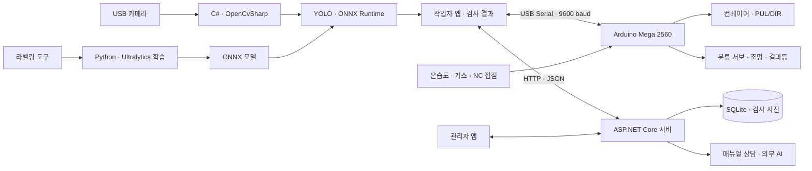

# 🏭 ProductionLine — 영상처리 기반 생산라인 검사·하드웨어 제어 시스템


컨베이어를 따라 이동하는 휴대폰을 카메라로 검사하고, 검사 기록·장비 상태·문제 대응을 관리자와 작업자가 함께 관리하는 생산라인 시스템입니다.

> 전체 팀 프로젝트를 소개하며, **pxjun99의 담당 영역인 영상처리 및 하드웨어 제어·연동 소스**를 공개합니다. 관리자 앱·서버·상담 AI 전체와 사용자 앱의 로그인·문제 관리 등 다른 담당 코드는 포함하지 않았습니다. 전체 시스템을 단독 실행하는 배포본은 아닙니다.

## 📌 프로젝트 개요

작업자 PC에서 카메라 영상을 수집하고 YOLO ONNX 모델로 휴대폰 위치·기종·파손 관련 클래스를 검출합니다. 검사 결과와 당시 사진은 서버로 전달하며, Arduino Mega와 USB 시리얼로 연결해 컨베이어·조명·분류 서보와 센서를 제어합니다.

관리자는 여러 라인의 상태와 검사 이력·통계를 확인하고 원격 운영 명령을 전달합니다. 작업자는 문제를 등록해 AI 매뉴얼 상담과 관리자 문의로 조치하고, 관리자는 완료 요청을 종결하거나 반려합니다. 실제 카메라·장비는 대표 라인 1개를 중심으로 연동하고 다른 라인은 가상 데이터로 구성합니다.

## ⚙️ 주요 기능 — 전체 프로젝트

| 영역 | 주요 기능 |
|---|---|
| 영상 검사 | 카메라 연결, 휴대폰 검출, 기종·파손 클래스 판정, 검출 박스·신뢰도 표시 |
| 검사 기록 | 제품 인식 시 결과·사진 저장, 최근 제품 사진 유지, 이력·통계 조회 |
| 관리자 | 로그인·권한, 다중 라인 현황, 사용자 관리, 원격 장비 운영 |
| 작업자 | 허용 라인 조회, 실시간 검사, 문제 등록·조치·완료 요청 |
| 협업·상담 | 매뉴얼 기반 상담, 외부 AI 연동, 관리자 문의·단체 채팅 |
| 하드웨어 | 벨트 구동·가속, 조명, 불량 분류 서보, 온습도·가스 입력, 경보·긴급정지 |
| 학습 도구 | 사진 박스 라벨링, YOLO 데이터 구성, 학습·ONNX 변환 |

## 👨‍💻 담당 역할 — 영상처리·하드웨어

| 담당 영역 | 구현 내용 | 주요 소스 |
|---|---|---|
| 카메라 처리 | OpenCvSharp 프레임 수집, 최신 JPEG·프레임 시각 관리, 연결 종료 처리 | [CameraSession.cs](02_UserApp/ProductionLine.UserApp/CameraSession.cs) |
| YOLO 추론 | ONNX 입력 전처리, 출력 파싱, 신뢰도·NMS 처리, 중첩 박스 정리, 결과 이미지 생성 | [YoloOnnxInspector.cs](04_Vision/ProductionLine.Vision/YoloOnnxInspector.cs) |
| 검사 연동 | 주기적 분석, 동일 제품 중복 기록 억제, 마지막 인식 제품 표시, 검사 결과·사진 전달 | [CameraInspection.cs](02_UserApp/ProductionLine.UserApp/CameraInspection.cs) |
| 라벨링·학습 도구 | 이미지 박스 편집, 클래스·라벨 관리, 데이터 분할, Python 학습·ONNX 내보내기 | [TrainingTool](06_TrainingTool/ProductionLine.TrainingTool) |
| PC 장비 통신 | COM 선택, 응답 확인·명령 직렬화, 센서 JSON 검증, 제품 인식·분류·가속 명령 | [ConveyorSerialController.cs](02_UserApp/ProductionLine.UserApp/ConveyorSerialController.cs), [HardwareSerialProtocol.cs](02_UserApp/ProductionLine.UserApp/HardwareSerialProtocol.cs) |
| 보드 제어·장비 연동 | Mega 펄스 출력, 센서·조명·결과등, 분류 예약, 긴급정지·통신 타임아웃 | [ConveyorYoloControl.ino](hardware/ConveyorYoloControl/ConveyorYoloControl.ino) |
| 업로드 도구 | 보드 설정 화면, Arduino 도구 준비·컴파일·업로드 연동 | [ArduinoFirmwareTools.cs](02_UserApp/ProductionLine.UserApp/ArduinoFirmwareTools.cs) |

기여 범위는 담당 기능을 기준으로 구분했습니다. 팀 통합 과정의 수정과 제공받은 모델이 포함되어 있으며, 모든 줄과 모델 학습 결과를 개인 단독 저작으로 주장하는 구성은 아닙니다. 함께 포함한 Arduino 라이브러리는 외부 의존성입니다.

## 🔄 시스템 구조



전체 서버의 현재 구성은 ASP.NET Core·EF Core·SQLite이며 사진과 일부 데이터는 파일로 저장합니다. 오래된 기획 문서의 JSON 전용 설명과 구분했습니다.

## 🔍 영상처리 흐름

1. 카메라의 최신 프레임과 촬영 시각을 읽습니다.
2. 이미지를 모델 입력 크기에 맞춰 전처리하고 ONNX Runtime으로 추론합니다.
3. 신뢰도·NMS와 중첩 박스 처리를 거쳐 휴대폰 및 파손 클래스를 정리합니다.
4. 결과 이미지·기종·신뢰도를 표시하고 새 제품에 대한 검사 기록과 사진을 전달합니다.
5. 구동 중인 벨트에 제품 인식 명령을 보내 가속과 선택적인 불량 분류를 연동합니다.

검사 타이머의 목표 간격은 100ms이고 작업자 앱의 기본 신뢰도 기준은 0.45입니다. 추론 시간에 따라 실제 간격은 길어질 수 있습니다. 제품 사이 빈 구간으로 다음 제품을 구분하므로, 겹치거나 빈틈없이 통과하는 여러 제품의 개별 추적을 보장하지 않습니다.

### 제공된 모델

| 항목 | 내용 |
|---|---|
| 파일 | `04_Vision/models/best.onnx` |
| 버전 | v5_merged_default |
| 입출력 | `[1,3,640,640]` → `[1,10,8400]` |
| 클래스 | iphone12_promax_crack, iphone16_white, iphone12_pro_silver, iphone15_pro_Natural_Titanium, iphone14_white, iphone8_crack |
| 판정 | 기종별 `_crack` 클래스 검출은 불량, 정상 기종 검출은 정상 판정에 사용 |
| 출처 기록 | 제공된 [model_info.json](04_Vision/models/model_info.json)에 원본 모델 출처·SHA-256 보존 |

검출 지원 클래스가 곧 모든 현장 조건에서의 기종·불량 판정 정확도를 뜻하지 않습니다. 서로 다른 시점의 기존 시험 수치는 현재 모델의 성능으로 재사용하지 않았습니다.

## 🏷️ YOLO 라벨링·학습 프로그램 — 담당 구현

검사용 모델을 준비하는 별도 Windows Forms 프로그램도 포함했습니다.

1. 새 라벨링 프로젝트를 만들거나 기존 프로젝트를 엽니다.
2. 사진을 가져와 클래스별 사각형 박스를 그리고 YOLO 라벨을 저장합니다.
3. 학습·검증 데이터와 클래스 설정을 구성합니다.
4. Python·YOLO 환경을 확인하고 학습 횟수·이미지 크기 등을 설정합니다.
5. Ultralytics 학습 후 `best.pt`와 `best.onnx`를 생성합니다.

| 파일 | 역할 |
|---|---|
| [MainForm.cs](06_TrainingTool/ProductionLine.TrainingTool/MainForm.cs) | 라벨링 프로젝트·학습 실행 화면 |
| [AnnotationCanvas.cs](06_TrainingTool/ProductionLine.TrainingTool/AnnotationCanvas.cs) | 사진 표시·박스 라벨 편집 |
| [YoloProject.cs](06_TrainingTool/ProductionLine.TrainingTool/YoloProject.cs) | 프로젝트·라벨·데이터셋 구성 |
| [train_yolo.py](06_TrainingTool/ProductionLine.TrainingTool/train_yolo.py) | YOLO 학습 및 ONNX 변환 |

## 🔌 하드웨어 구성

| 장비 | Mega 신호 핀 | 기능 |
|---|---|---|
| 모터 드라이버 | PUL D5 / DIR D6 | Timer3 펄스, DIR LOW |
| NeoPixel 조명 | D7 | 검사 조명 켜기·끄기 |
| DHT11 | D30 | 온도·습도 읽기 |
| MQ9 모듈 | A0 | 가스 센서 아날로그 원시값 |
| 분류 서보 | D11 | 기본 0°, 분류 시 55° |
| NC 긴급정지 접점 | D12–GND | 접점 개방 시 정지 잠금 |
| 부저 | D8 | 경보 출력 |
| 빨강·초록 결과등 | D40 / D42 | 경보·검사 결과 표시 |

현재 V7 펌웨어는 기본 펄스 반주기 100µs, 제품 인식 시 50µs 가속을 사용합니다. 기본 가속 유지 시간은 3초이며 PC에서 설정할 수 있습니다. 모터 구동 펄스가 없는 상태에서 제품 인식 명령만으로 벨트를 출발시키지 않습니다.

분류 위치는 촬영 프레임 경과 시간과 명령된 속도 변경 이력을 반영해 예약합니다. 실제 속도를 측정하는 엔코더나 통과 센서 기반 폐루프 제어는 아니므로 이동 시간·제품 간격은 현장 보정이 필요합니다. MQ9 값은 ppm 농도가 아닌 0~1023 원시값입니다. NC 입력 정지와 별도로 실제 장비에는 구동 전원 차단 회로가 필요하며, 본 펌웨어를 안전 인증 제어기로 설명하지 않습니다.

명령·배선·운영 조건은 [펌웨어 안내](hardware/ConveyorYoloControl/README.md)를 참고하세요.

## 🛠️ 기술 스택

| 구분 | 기술 |
|---|---|
| 담당 PC 코드 | C#, .NET 8, Windows Forms |
| 영상처리 | OpenCvSharp, YOLO, ONNX Runtime |
| 학습 | Python, Ultralytics, ONNX export |
| 장비 | Arduino Mega 2560, Arduino C++, Timer3, USB Serial |
| 전체 시스템의 기타 영역 | ASP.NET Core, EF Core, SQLite, HTTP/JSON, 상담 AI |

## 📁 공개 소스 구조

```text
ProductionLine-Vision-Control/
├── 02_UserApp/ProductionLine.UserApp/   # 카메라·검사·장비 연동 관련 파일만
├── 04_Vision/
│   ├── ProductionLine.Vision/         # YOLO 추론·판정
│   ├── models/                        # 제공 모델·메타데이터·빈 벨트 기준 사진
│   └── samples/                       # 실행 확인용 제공 사진 1장
├── 06_TrainingTool/                    # 라벨링·학습 도구
├── hardware/ConveyorYoloControl/       # 펌웨어와 외부 라이브러리·라이선스
└── docs/                              # 공개 범위·검증 결과
```

## 🔧 코드 확인 및 실행 범위

**라벨링·학습 도구**는 Windows와 .NET 8 SDK에서 독립 빌드할 수 있습니다.

```powershell
dotnet build 06_TrainingTool/ProductionLine.TrainingTool -c Release
dotnet run --project 06_TrainingTool/ProductionLine.TrainingTool
```

Python 학습에는 별도의 Python·Ultralytics 환경과 라벨링한 데이터가 필요합니다. 제공 모델은 포함했지만 전체 학습 데이터셋은 포함하지 않았습니다.

**영상 검사 및 사용자 앱 연동 파일**은 원본 팀 프로젝트의 `00_Shared` 계약 타입과 사용자 앱 공통 화면·API에 의존합니다. 다른 담당 소스는 제외했으므로 이 저장소만으로 전체 사용자 앱을 빌드할 수 없습니다. 원본 `.csproj`의 참조를 유지했습니다.

**펌웨어**는 Arduino IDE에서 `hardware/ConveyorYoloControl/ConveyorYoloControl.ino`를 Mega 2560 대상으로 확인할 수 있습니다. 폴더 안의 외부 라이브러리와 라이선스를 함께 유지하세요. 이 저장소 정리 작업은 보드 업로드나 실제 장비 구동을 수행하지 않습니다.

파일별 공개 범위와 제외 항목은 [CODE_SCOPE.md](docs/CODE_SCOPE.md), 이번 검사 결과는 [VALIDATION.md](docs/VALIDATION.md)를 확인하세요.
